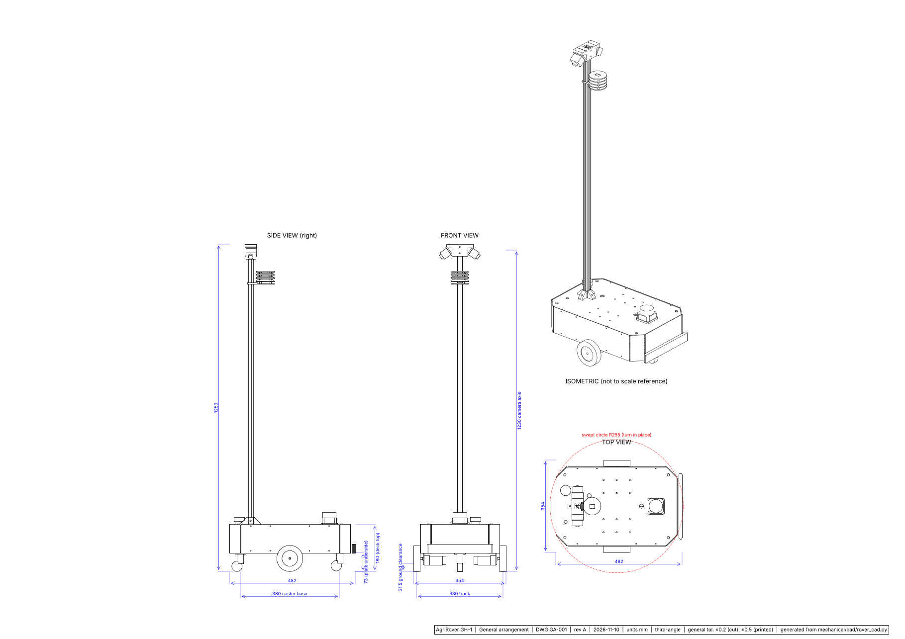
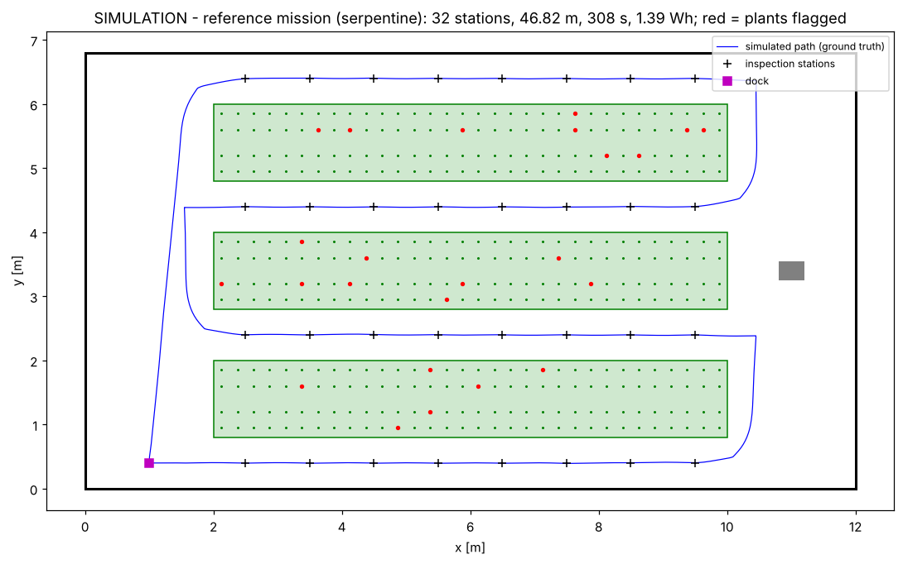
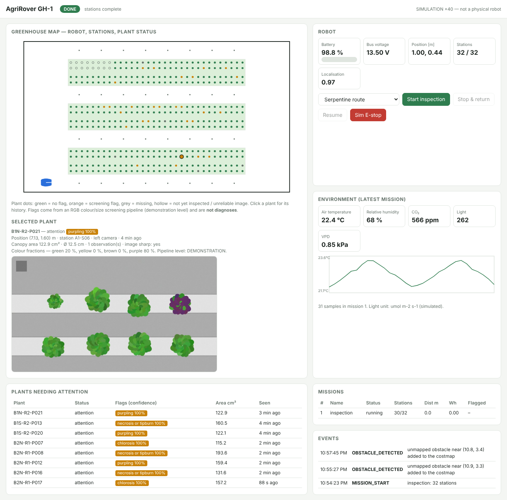

# AgriRover GH-1 — autonomous greenhouse inspection rover

A compact differential-drive rover that drives greenhouse aisles on its own, stops at fixed stations, photographs the
plants on both sides, logs air temperature, humidity, CO₂ and light, ties every observation to a plant position on a
map, and shows the results on a web dashboard. First crop: bench-grown lettuce. Inspection only — no spraying,
harvesting or manipulation.



| | |
|---|---|
| Size / mass | 482 × 354 × 1253 mm, 9.4 kg empty, 11.4 kg with 2 kg payload |
| Drive | 2 × Pololu 37D 70:1 gearmotors, 100 mm wheels, centre axle + 2 casters; 0.3 m/s in aisles, 0.5 m/s max; turns in place (Ø 0.56 m) |
| Power | 12.8 V 12 Ah LiFePO₄ with BMS; ≈ 16 W average → ≈ 7.8 h estimated |
| Compute | Raspberry Pi 5 (Ubuntu 24.04, ROS 2 Jazzy, Nav2) + STM32F411 real-time base controller |
| Sensing | RPLIDAR C1, wheel encoders, gyro, 2 RGB cameras with grey reference card, SHT45, SCD41, AS7341, contact bumper |
| Custom electronics | ARC-1 carrier board: fusing, reverse-polarity protection, E-stop chain with delayed cut, battery monitor |
| Prototype cost | ≈ 1 420 USD in parts (estimate, Nov 2026) |

## What exists, and how far each part has been taken

This repository is a design-and-software package produced **without hardware**. The table says exactly what has been
checked. Details and the physical test plan: [`docs/10_validation_test_report.md`](docs/10_validation_test_report.md).

| Deliverable | Where | State |
|---|---|---|
| Requirements, architecture, trade studies | `docs/01`–`03` | written; requirements cross-checked against the calculations by a test |
| Mechanical calculations | `mechanical/calcs/` | scripted, reproducible; analytical only |
| Parametric CAD: STEP assembly, part STEPs, STL, 3MF, DXF, dimensioned drawings | `mechanical/cad/`, `mechanical/export/` | generated with CadQuery; 0 interferences; purchased parts are envelope models; **not built** |
| Electrical calculations | `electrical/calcs/` | scripted; analytical only |
| ARC-1 schematic, 2-layer layout, Gerbers, drill, pick-and-place, BOM | `electrical/pcb/` | generated; KiCad-extracted netlist equals the design; KiCad DRC: 0 clearance/short/unconnected; **GUI ERC and human review still required; not fabricated** |
| Base-controller firmware | `firmware/` | portable core: 31 host checks pass; STM32 build links (6.6 kB); **never run on an MCU** |
| Core software: kinematics, planner, controller, localisation, vision, mission logic, storage | `software/agrirover/` | 39 automated tests pass, including 14 simulated system scenarios |
| Headless greenhouse simulator | `software/agrirover/sim/` | used for all scenario tests; simplified 2D model |
| Web dashboard + HTTP API | `dashboard/` | works against the simulator; API tests pass |
| ROS 2 Jazzy workspace: URDF, Nav2/AMCL/keep-out/EKF/SLAM configuration, Gazebo world, base bridge, mission and sensor nodes | `ros2_ws/` | statically checked only — **never executed** (ROS 2 could not be installed where this was written) |
| Computer vision | `software/agrirover/vision/`, `docs/07` | classical pipeline verified on **synthetic** images only; no trained model; no claim about real plants |
| BOM, sourcing, cost | `manufacturing/` | 33 lines; ~40 % of the cost on web-checked prices, the rest recalled/estimated and flagged |
| Assembly, operating, troubleshooting, safety documents | `docs/06`, `11`–`13` | written from the design; unproven until a build |
| Research extension | `research/` | three simulation model studies + proposal outline |

## Try it (no hardware, about five minutes)

```bash
cd agrirover
pip install -e "software[dashboard,dev]"

python -m agrirover.sim.run --out data/runtime/demo        # one full inspection mission in the reference greenhouse
python -m agrirover.sim.scenarios                          # 14 scenarios with pass/fail criteria (~1.5 min)
AGRIROVER_MODE=sim uvicorn dashboard.app:app --port 8080   # then open http://localhost:8080 and press "Start inspection"
```




## Rebuild every artefact from source

```bash
make calcs        # mechanical + electrical calculation reports
make cad          # STEP / STL / 3MF / DXF / drawings            (needs cadquery, matplotlib)
make pcb          # schematic, routed board, DRC, Gerbers, BOM   (needs KiCad 7, numpy, scipy, opencv)
make firmware     # host tests + STM32 cross-build               (needs gcc, arm-none-eabi-gcc)
make ros-assets   # map, keep-out mask, Gazebo world, stations from config/greenhouse.yaml
make test         # Python test-suite
make report       # docs/10_validation_test_report.md from the results above
make all
```

Single sources of truth: `config/rover.yaml` (robot), `config/greenhouse.yaml` (site),
`electrical/pcb/gen/design.py` (board netlist), `firmware/core/protocol.h` (wire protocol).

## Build order for a physical robot

1. Read `docs/13_safety.md` and the "not verified" table in `docs/10`.
2. Order purchased parts (`manufacturing/bom_master.csv`); measure them; correct CAD constants; cut plates, print parts.
3. Review ARC-1 in the KiCad GUI (ERC, footprints, Black Pill pinout), then order boards.
4. Assemble and bring up following `docs/06_assembly_guide.md`.
5. Install the software on the Pi (`ros2_ws/README.md`), survey the site (`docs/11` §9), calibrate the cameras (`docs/07` §5).
6. Execute the physical test plan (`docs/10` §4) before any unattended operation.

## Documentation

`docs/01_requirements` · `02_architecture` · `03_design_decisions` · `04_electrical` · `05_mechanical` ·
`06_assembly_guide` · `07_computer_vision` · `08_dashboard_api` · `09_manufacturing_guide` ·
`10_validation_test_report` · `11_operating_manual` · `12_troubleshooting` · `13_safety` · `research/README`

## Licence and dependencies

Project files: MIT (see `LICENSE`). Runtime dependencies are listed in `software/pyproject.toml` and
`ros2_ws/README.md`; all are open source (NumPy, SciPy, OpenCV, PyYAML, pyserial, FastAPI, uvicorn; optional ONNX
Runtime and Adafruit sensor drivers; ROS 2 Jazzy, Nav2, slam_toolbox, robot_localization, sllidar_ros2, v4l2_camera).
Design tools: CadQuery, KiCad 7, GCC.
